# Terrain graph library

Twenty ready graphs for the terrain graph editor (Generate workspace > Nodes > Graphs > *Library*). Every picture is rendered from the graph itself by `scripts/make_graph_thumbs.py`
(shaded relief with cast shadows, land colours, water, the texture layers tinted on top; preview resolution of a 1025 map). The graphs are written by `scripts/make_graph_library.py`.

Conventions: sizes are shares of the map width (a *Map share* node wired into the scale / radius / width port), so a graph looks the same on every map size; texture layers 2 cliff / rock,
3 sand, 4 snow / ice, 5 lush, 6 rock outcrops, 7 dark / occluded; competitive layouts have ONE base pad in the master part of the map and a *Symmetrize* node that copies it.

| Picture | Graph | What it makes |
|---|---|---|
| 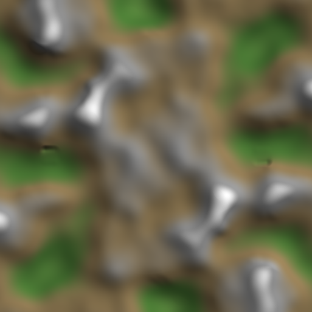 | **Duel: two bases, turned 180 degrees** `lib_duel_turn` | Competitive 1v1 base: hybrid multifractal hills made symmetric by a 180 degree turn (the average of the two images: continuous, exactly symmetric), a flat base pad on each side, the slope limited to what land units cross, textured by slope and wetness. Check: the blocked ground view. |
| 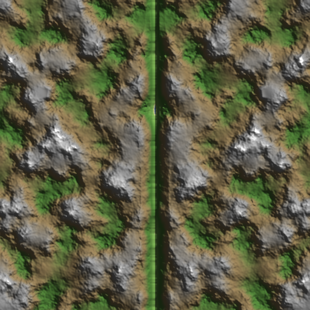 | **Duel: a river down the middle** `lib_duel_river` | Mirrored 1v1 map: rolling hills with a river on the symmetry axis, bases on both sides (one pad, mirrored), sand along the water, slope limited so every bank is passable. |
| 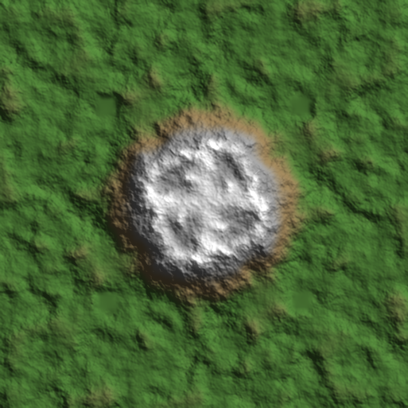 | **Four players: corners, a central plateau** `lib_ffa4_corners` | Four-fold turn (the average of the four images: exactly symmetric and continuous), a base pad in each corner, rolling terrain, a raised plateau in the middle every player can reach by a ramp, pathable slopes. Check: blocked ground. |
| 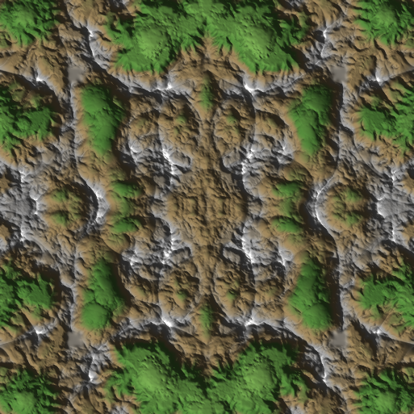 | **Four players: mirrored ridges** `lib_ffa4_diag` | Four-fold mirror (both axes): ridged mountains between the bases, a base pad per corner, slope limited so passes between ridges stay open. Rock layer from the rockiness mask. |
| 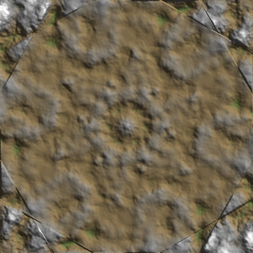 | **Six players: a hexagon** `lib_hex6` | Six-fold turn: the average of the six images (exactly symmetric when the map centre is on the sample lattice, continuous), a base pad for every player on a ring, slope limited. Change N in the Symmetrize node (and add pads) for 3, 4, 5 or 8 players. |
| 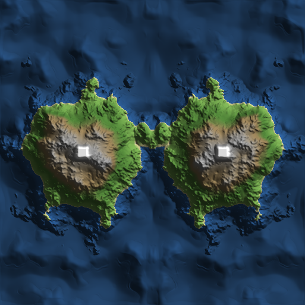 | **Two islands, a shallow channel** `lib_two_islands` | Naval 1v1: two ragged islands mirrored across the middle, hydraulic erosion, sand on the shore band, a pad for each base. Look at the map in the water view. |
| 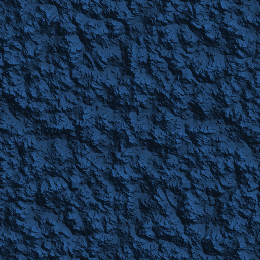 | **Archipelago, four-fold fair** `lib_archipelago_fair` | Cell noise cut into islands (warped coast), a four-fold turn (larger of the four images) so each player gets the same islands, a base pad on each, hydraulic erosion, beach sand. |
| 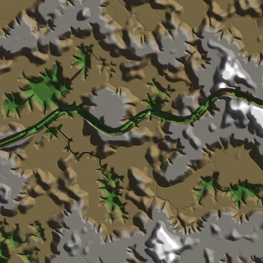 | **Canyon with a river** `lib_canyon_river` | A terraced plateau cut by stream-power gorges and a river along a path: U-shaped canyon, rock layers (stratify) on the walls, sand on the river bed, a pad on each rim. |
| 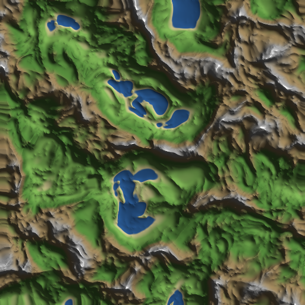 | **Highlands: massifs and valley floors** `lib_highlands` | Mountain preset scaled to heights, sediment settles in the valley floors (flat building ground), rock layers on the steep faces, thermal talus, snow on the tops. The pad node flattens a base in a valley. |
| 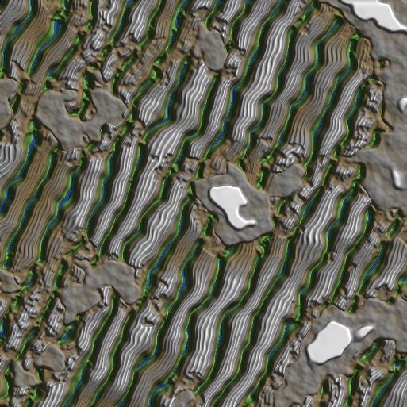 | **Desert: dunes and mesas** `lib_desert_dunes` | Dune fields (asymmetric ridges with a meandering crest) between mesas, shaped by wind erosion, dry mud cracks on the flats; sand where the wind put it, rock on the faces. |
| 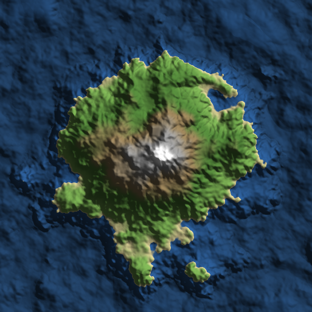 | **Tropical island** `lib_tropics` | A ragged island of soft hills, hydraulic erosion cuts the valleys, wetness makes the lush ground, a sand beach on the shore, dark undergrowth in the cavities. The base pad sits on the highest ground of its area. |
| 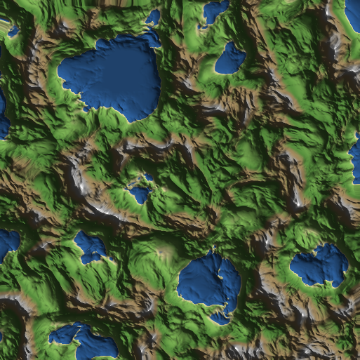 | **Alpine: glaciers and snow** `lib_alpine` | Ridged mountains, a glacier grinds U-shaped valleys above the equilibrium line, snow lies above the snow line and slumps off the steep faces, bare rock where it is steep or convex. |
| 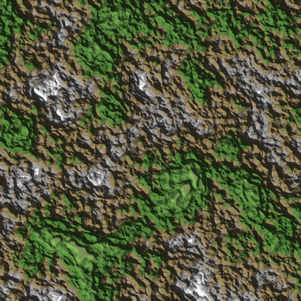 | **Badlands: layered rock** `lib_badlands` | Stepped mesas, strongly layered cliffs (stratify), rock and soil split (soil slides into the hollows), dry cracks on the soil, cavity-darkened gullies. |
| 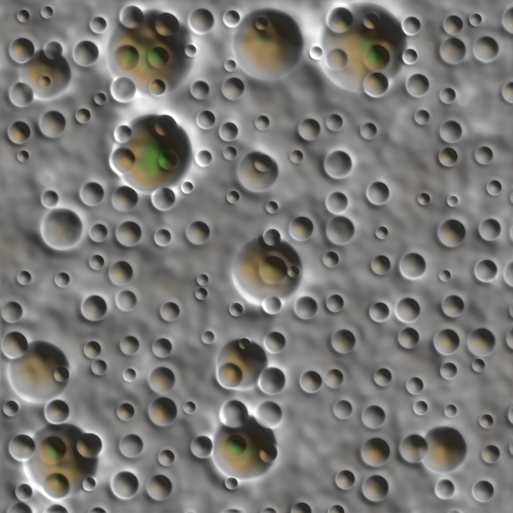 | **Moon: craters** `lib_moon` | Two sizes of impact craters on gentle terrain, settled and slope limited so the rims are climbable; cavity mask for the dark crater floors. |
| 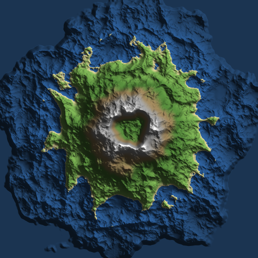 | **Volcano island** `lib_volcano` | A cone with a crater (a drawn radial profile), warped and roughened by ridged noise, thermal slides, an ash apron; the coast is a ragged island shape. |
| 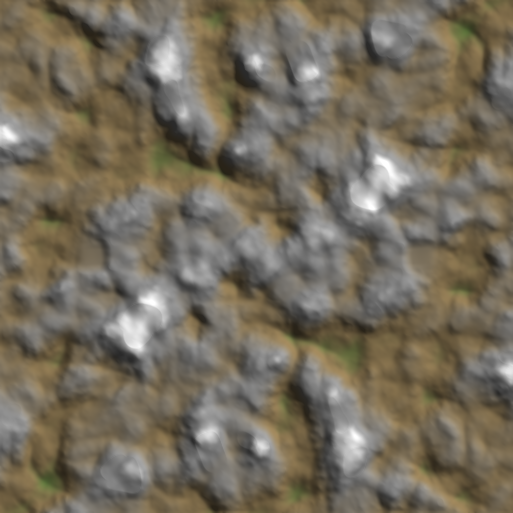 | **Tundra: soft hills, snow and bogs** `lib_tundra` | Low rolling hills, sediment settles into bogs (wetness), a thin snow cover that slumps off slopes, pathable throughout; two bases by a 180 degree turn (averaged images). |
| 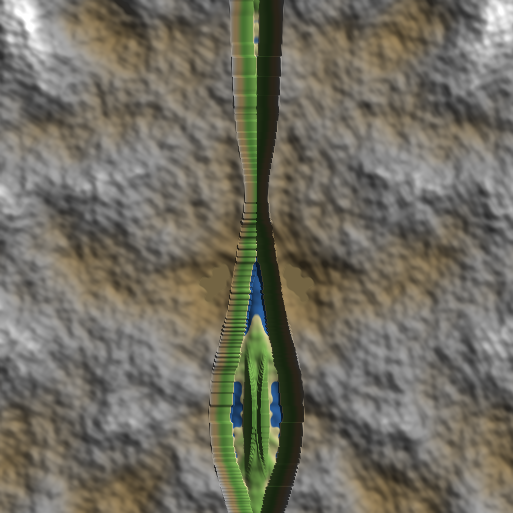 | **Rift valley between two plateaus** `lib_rift_valley` | Two plateaus mirrored across a deep rift (a wide U canyon along a path), cracks and layered cliffs on the rift walls, ramps are left to the slope limit; sand on the rift floor. |
| 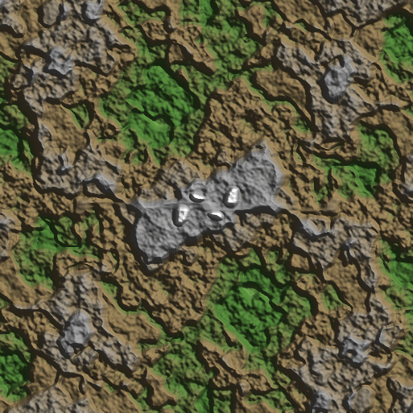 | **Mesa fortress: bases on plateaus** `lib_mesa_fortress` | Terraced mesas made symmetric by a 180 degree turn, a flat base pad on a plateau for each player, a ramp path down to the low ground, slope limited, regions measured: every base has to be one connected region. |
| 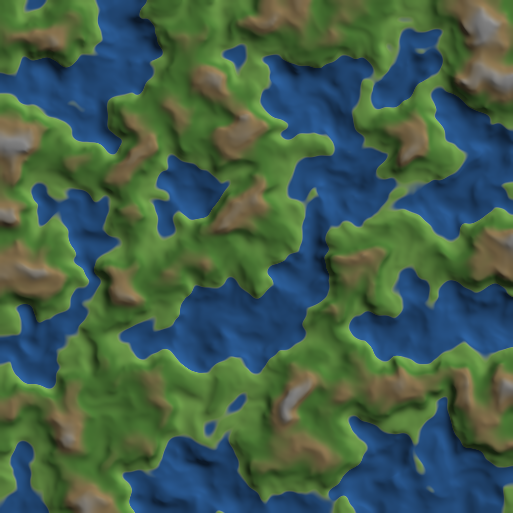 | **Wetlands: meanders and shallow lakes** `lib_wetlands` | Nearly flat country bent by a curl flow into meanders, sediment settles in the hollows (lakes where it dips under the water), wetness and the shore band texture the ground; fully pathable. |
| 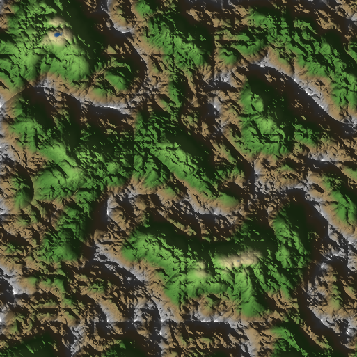 | **Texture and colour pass (no height change)** `lib_colour_pass` | Reads the heights of the map and paints layers from analysis masks: cliffs, lush ground by wetness, rock by rockiness, dark cavities, the sunlit sides; also writes a colour map (hillshade x terrain colour ramp) to a DDS file on Build. |
